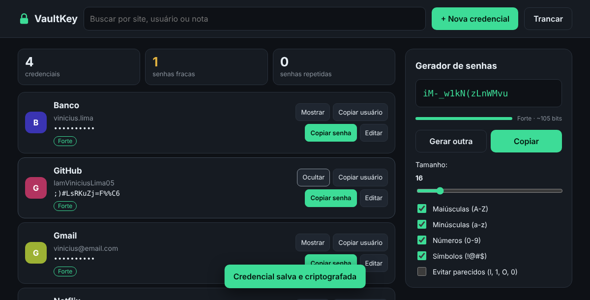

# VaultKey — Cofre de senhas

Cofre de senhas que guarda as credenciais **criptografadas** no localStorage, com busca e gerador de senhas seguras.

🔗 **[Ver o site no ar](https://iamviniciuslima05.github.io/PROJETO-VaultKey/)**



## Funcionalidades

- **Senha mestra** que nunca é salva
- Criptografia **AES-GCM de 256 bits** com chave derivada por **PBKDF2** (SHA-256, 310 mil iterações), pela Web Crypto API
- Cadastro, edição e exclusão de credenciais (site, endereço, usuário, senha e notas)
- **Busca** por site, usuário ou notas
- **Gerador de senhas** com tamanho e tipos de caracteres configuráveis, usando números aleatórios criptográficos
- **Medidor de força** da senha
- Aviso de **senhas fracas e repetidas**
- Copiar usuário ou senha com um clique
- **Trava automática** após 5 minutos sem uso

## Tecnologias

HTML5 · CSS3 · JavaScript · Web Crypto API · localStorage

## Estrutura

```
index.html
css/style.css
js/cripto.js   → criptografia (PBKDF2 + AES-GCM)
js/script.js   → cofre, gerador e interface
```

## Como rodar

Não precisa instalar nada: baixe o projeto e abra o `index.html` no navegador, ou acesse a versão publicada acima.

> Projeto de estudo. Para guardar senhas reais, prefira um gerenciador de senhas auditado, como o Bitwarden.

---
Feito por **Vinicius Lima** · [Portfólio](https://viniciuslimadev.netlify.app) · [LinkedIn](https://www.linkedin.com/in/viniciuslima25/)
